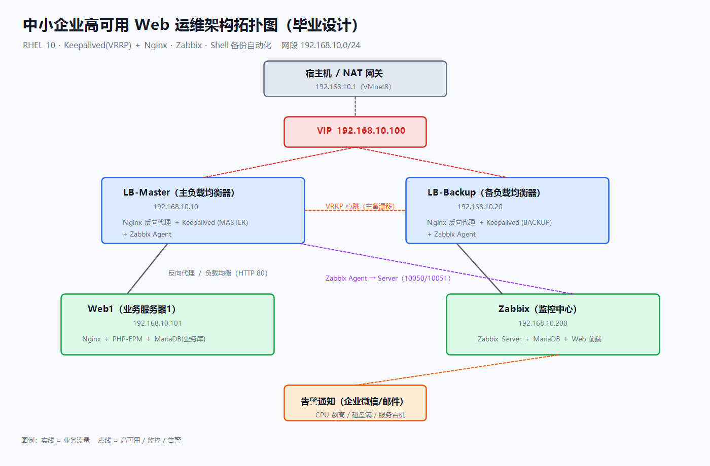
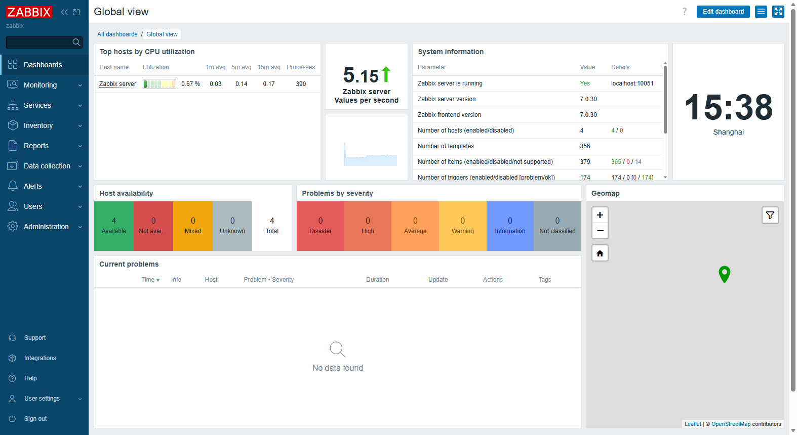
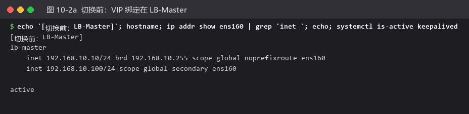
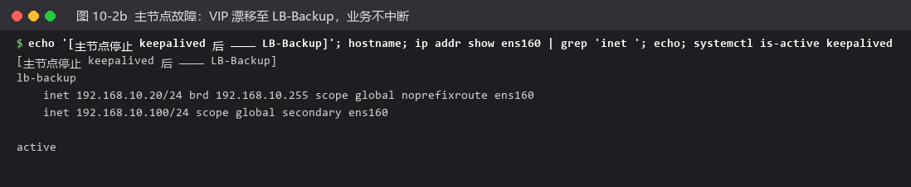
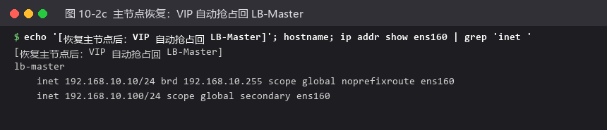
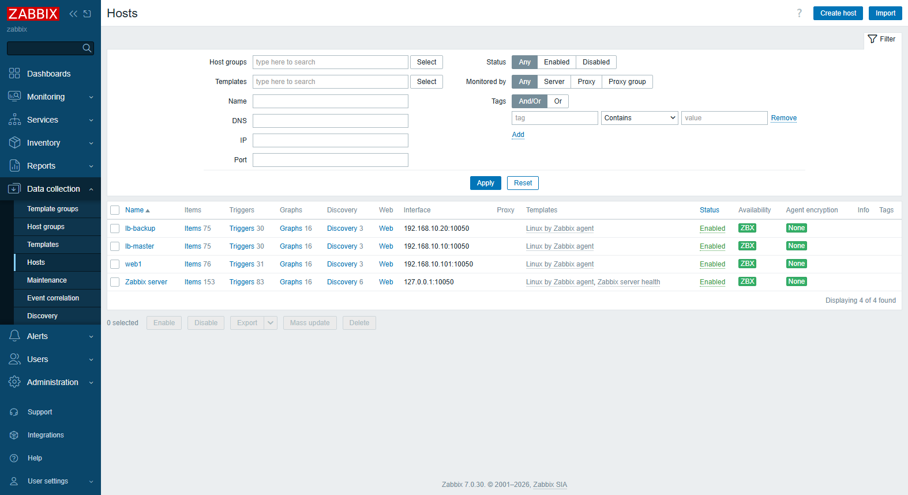
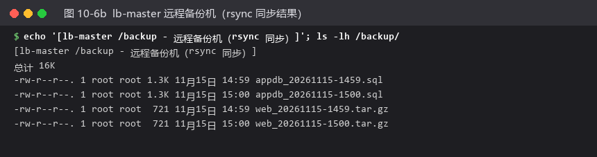
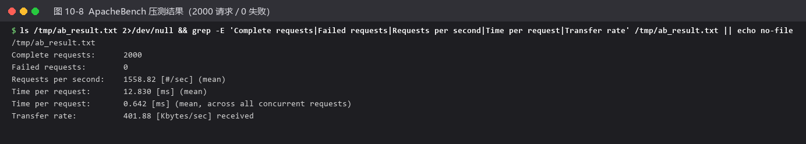

# 中小企业高可用 Web 运维架构设计与实现（毕业设计）

基于开源技术栈，为中小企业设计一套低成本、易维护的高可用 Web 业务运维架构，解决**单点故障导致业务中断、缺乏监控告警、数据无备份**三大运维痛点。本仓库为毕业设计的落地交付物：完整配置文件、自动化脚本、拓扑图与验证截图。

## 技术栈

- **高可用**：Keepalived (VRRP) + Nginx 反向代理/负载均衡
- **监控告警**：Zabbix 7.0 LTS（Server + Agent2，自定义监控项 + 企业微信/邮件告警）
- **自动化**：Shell + Crontab（定时备份、日志切割）、Rsync（远程同步）
- **操作系统**：Red Hat Enterprise Linux 10（VMware Workstation 虚拟化）

## 网络拓扑



### IP 规划（NAT 网段 192.168.10.0/24，网关 192.168.10.2）

| 主机 | IP | 角色 |
| :--- | :--- | :--- |
| lb-master | 192.168.10.10 | 主负载均衡器（Keepalived MASTER + Nginx） |
| lb-backup | 192.168.10.20 | 备负载均衡器（Keepalived BACKUP + Nginx） |
| web1 | 192.168.10.101 | 业务服务器（Nginx + PHP-FPM + MariaDB） |
| zabbix | 192.168.10.200 | 监控中心（Zabbix Server + MariaDB + Web 前端） |
| VIP | 192.168.10.100 | 虚拟 IP（Keepalived 自动漂移） |

## 核心功能演示

### 1. VIP 漂移（高可用）

- 主节点（LB-Master）Keepalived 故障时，VIP 在 **1~3 秒**内漂移至备节点（LB-Backup）
- 业务中断时间 **< 1 分钟**，前端访问地址始终为 `http://192.168.10.100`

### 2. Zabbix 监控告警



- 自定义监控项：CPU 负载、内存使用率、磁盘使用率、Nginx 80 端口存活
- 阈值触发器 + 企业微信机器人/邮件告警，实现 7×24 小时故障主动发现

### 3. 自动化备份与灾难恢复

- 每日凌晨 2:00 自动备份网站目录与 MySQL 业务库（`scripts/backup.sh`）
- Rsync 增量同步至远程备份机（LB-Master），保留最近 7 天备份
- 灾难恢复演练：删除站点文件后从备份一键恢复，验证数据完整性

### 4. 验证截图（实测）

| VIP 切换前 | 主节点故障（VIP 漂移） | 主节点恢复（自动抢占） |
| :---: | :---: | :---: |
|  |  |  |

| 监控主机全部在线 | 远程备份两端一致 | 压测结果 |
| :---: | :---: | :---: |
|  |  |  |

全部 22 张截图见 [`screenshots/`](screenshots/README.md)（终端截图为真实 SSH 命令与原始输出渲染，Zabbix 面板为浏览器真实截图）。

## 目录结构

```
├── topology/        # 网络拓扑图
├── config/          # Keepalived / Nginx / Zabbix / agent 配置文件
├── scripts/         # Shell 备份脚本、Zabbix 告警脚本、UserParameter
├── screenshots/     # 验证截图（VIP 漂移、监控面板、告警、备份恢复）
└── docs/            # 部署手册与故障应急处理预案
```

## 快速部署

详见 `docs/部署手册.md`（基于 RHEL 10：dnf 安装、订阅注册、firewalld 放行、SELinux permissive）。

## 作者

[杨斌] - 网络工程23级1班 - [2027]
